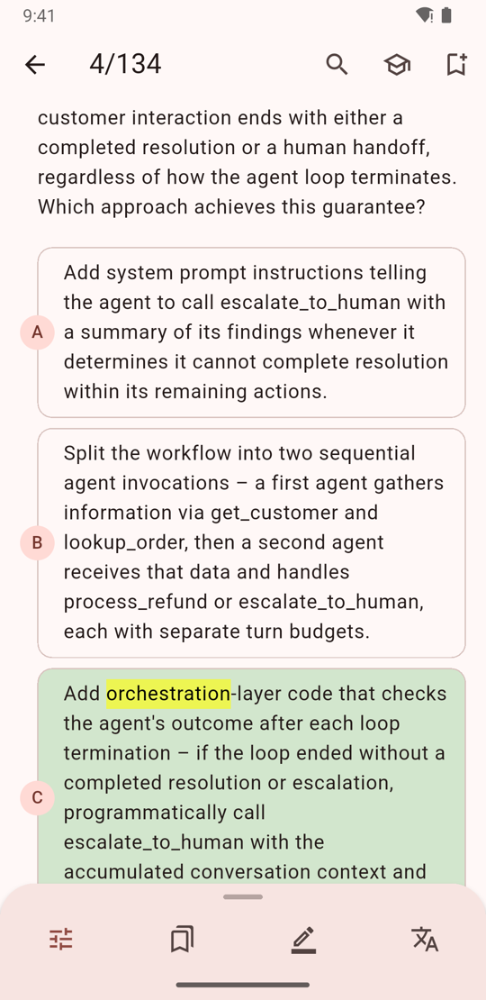
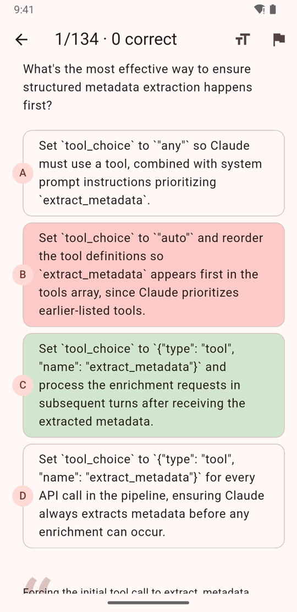
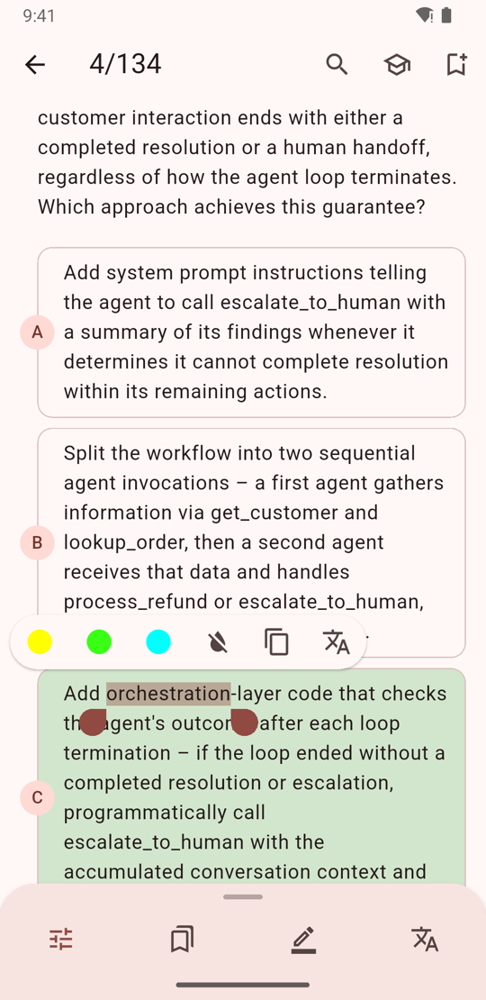
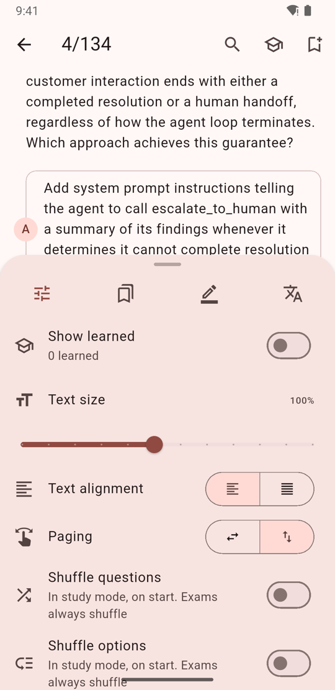
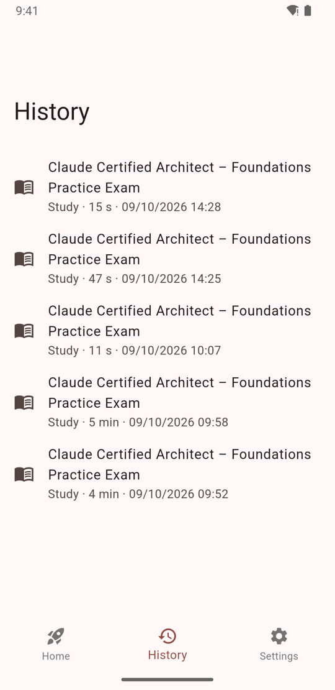
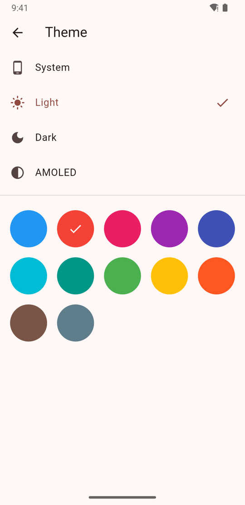

# Evaluator

A Flutter app for studying multiple-choice question banks. Banks ship as JSON files in `assets/evaluations/` and everything is stored on the device: there is no backend.

<p>
  
  
  
</p>

## Features

**Study mode**: questions with the correct answer marked.
- Vertical or horizontal paging, with a slider to jump between questions that hides while you scroll down.
- Save questions, mark them as learned (hidden in the next session) and search by text.
- Highlight text with neon colors, copy it and translate it (English → Spanish with Google Translate).
- Optionally hide the answers until you tap an option.
- Picks up where you left off.

**Exam mode**: shuffled questions and options, a score at the end, and an option to reveal the answers only when you finish.

**History** of study sessions and exams, a light/dark/AMOLED **theme** with a choice of color, and reading settings (text size and alignment).

<p>
  
  
  
  
</p>

## Getting started

Requires Flutter ≥ 3.47.

```bash
flutter pub get
flutter run
flutter analyze
flutter test
```

## Adding a question bank

Drop a JSON file in `assets/evaluations/<id>.json`; the app finds it on its own.

```json
{
  "id": "biology-midterm-1",
  "title": "Biology – Midterm 1",
  "questions": [
    {
      "id": 1,
      "question": "What is the basic unit of life?",
      "options": ["Atom", "Cell", "Tissue", "Organ"],
      "answers": [1],
      "explanation": "Optional"
    }
  ]
}
```

- `id` in kebab-case, equal to the file name.
- `answers` are 0-based indexes into `options`; more than one makes a multi-answer question.

Then validate the file with `flutter test test/evaluations_test.dart`. The full rules are in [CLAUDE.md](CLAUDE.md#evaluation-json-format).

## Distribution

Signed APK to Firebase App Distribution (needs `android/key.properties`, the keystore and `firebase login`):

```bash
scripts/distribute.sh "release notes" [testers-group]
```

Before each release, bump only the patch and the build number in `pubspec.yaml` (`1.9.0+10` → `1.9.1+11`).

## Architecture

Clean Architecture in three layers (`presentation → domain ← data`), with GetX for dependency injection and state. Details in [CLAUDE.md](CLAUDE.md#architecture).
